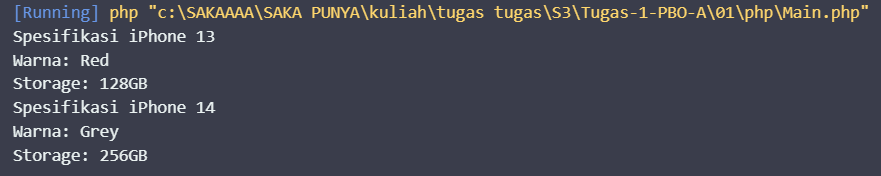
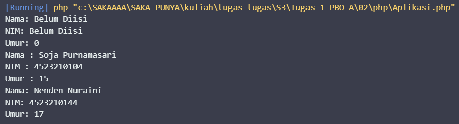
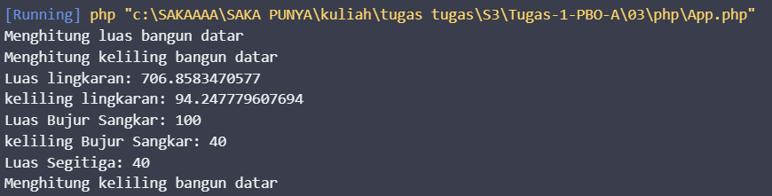
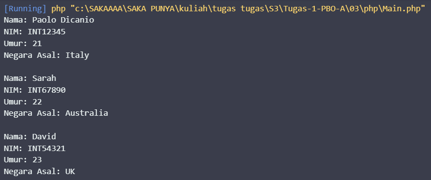
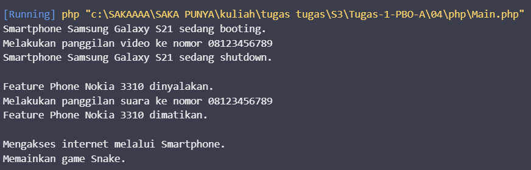
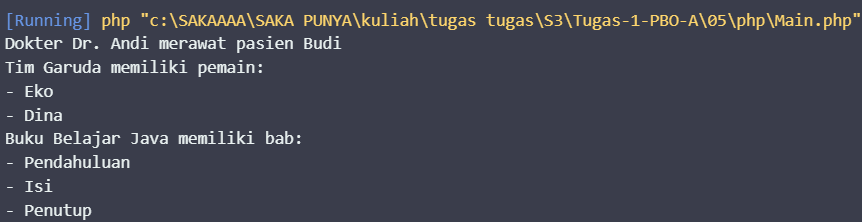
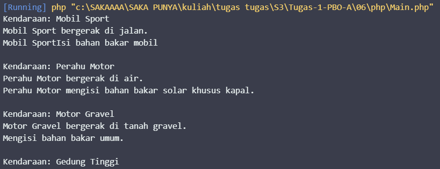

# PEMROGRAMAN BERORIENTASI OBJEK

## Biodata

| **Keterangan** | **Isi** |
|---|---|
| Nama | **Saka Laksmana Harimurti** |
| NIM | **4525210067** |
| Program Studi | **Teknik Informatika** |
| Kelas | **A** |
| Mata Kuliah | Pemrograman Berorientasi Objek |
| Dosen Pengampu | **Adi Wahyu Pribadi, S.Si., M.Kom** |
| Semester | **3 (Ganjil)** |

# Tugas 1 PBO A

Repository ini berisi kumpulan 6 tugas praktikum Pemrograman Berorientasi Objek (PBO).

Setiap tugas dibuat menggunakan Java dan PHP untuk menerapkan berbagai konsep dasar Pemrograman Berorientasi Objek.

---

## Tugas 1 - Class

Pada tugas ini dibuat class `iPhone` dengan beberapa atribut seperti `color` dan `storage`. Program kemudian membuat object iPhone 13 dan iPhone 14 untuk menampilkan spesifikasinya.

Konsep yang dipelajari:

* Class dan Object
* Attribute / Property
* Constructor
* Method
* Getter

### Dokumentasi / Screenshot

---

## Tugas 2 - Constructor

Tugas ini menggunakan class `Mahasiswa` yang memiliki atribut nama, NIM, dan umur. Program menerapkan constructor serta getter dan setter untuk mengakses dan mengubah data.

Konsep yang dipelajari:

* Constructor
* Getter dan Setter
* Encapsulation
* Object

### Dokumentasi / Screenshot

---

## Tugas 3 - Inheritance

Tugas ini menerapkan konsep inheritance atau pewarisan. Class turunan dapat mewarisi atribut dan method dari class induknya.

Program juga menggunakan beberapa class bangun datar seperti `Lingkaran`, `Persegi`, dan `Segitiga` untuk menerapkan method sesuai kebutuhan masing-masing class.

Konsep yang dipelajari:

* Inheritance
* Parent Class dan Child Class
* Method Overriding
* Pewarisan atribut dan method
* Perhitungan luas dan keliling

### Dokumentasi / Screenshot

---

## Tugas 4 - Polimorfisme   

Tugas ini menerapkan konsep polimorfisme menggunakan class `Handphone`, `Smartphone`, dan `FeaturePhone`.

Method seperti `nyalakan()`, `matikan()`, dan `telepon()` memiliki perilaku yang berbeda sesuai dengan object yang digunakan.

Konsep yang dipelajari:

* Polimorfisme
* Inheritance
* Method Overriding
* Parent Class dan Child Class

### Dokumentasi / Screenshot

---

## Tugas 5 - Asosiasi dan Komposisi

Tugas ini membahas hubungan antar-object dalam Pemrograman Berorientasi Objek.

Contoh hubungan yang digunakan:

* Asosiasi: Dokter berhubungan dengan Pasien.
* Agregasi: Tim memiliki beberapa Pemain.
* Komposisi: Buku memiliki beberapa Bab.

Konsep yang dipelajari:

* Association
* Aggregation
* Composition
* Hubungan antar-object

### Dokumentasi / Screenshot

---

## Tugas 6 - Abstract dan Interface

Tugas ini menerapkan abstract class dan interface. Beberapa class menggunakan interface untuk menentukan method yang harus dimiliki oleh class tersebut.

Program menggunakan beberapa class seperti `Vehicle`, `Car`, `Boat`, dan `Motor`.

Konsep yang dipelajari:

* Abstract Class
* Interface
* Implementasi Interface
* Multiple Interface
* Method Overriding
* Inheritance

### Dokumentasi / Screenshot

---

## Bahasa Pemrograman

* Java
* PHP

---

## Tujuan

Kumpulan tugas ini dibuat untuk memahami dan menerapkan konsep dasar Pemrograman Berorientasi Objek, mulai dari class dan object hingga inheritance, polymorphism, association, aggregation, composition, abstract class, dan interface.

## Disclaimer

Tugas ini dikerjakan dengan bantuian AI dan Bantuan dari teman - teman saya.